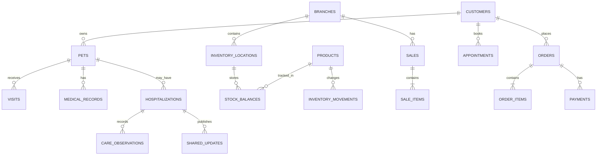

### Spesifikasi Implementasi Lengkap

### Sistem Operasional Terintegrasi Pet Shop & Klinik Hewan

Versi 2.0 · 25 Oktober 2026 · Target deployment: Vercel + Supabase

Dokumen ini menjadi acuan implementasi bagi developer untuk membangun sistem dari awal sampai siap digunakan, dengan akun Vercel, Supabase, dan GitHub yang sudah tersedia. Targetnya bukan sekadar website katalog, melainkan sistem operasional terpadu untuk toko, klinik, rawat inap, grooming, penitipan, keuangan, dan pelanggan.

Prinsip utama desainnya:

* Satu website responsif untuk komputer, tablet, dan HP.

* Satu database dengan dukungan banyak cabang.

* Satu sistem inventori bersama untuk pet shop dan klinik.

* Pembayaran manual tanpa payment gateway.

* Hak akses berbeda untuk pemilik, dokter, admin, dan pelanggan.

* Data medis, stok, pembayaran, dan transaksi keuangan harus dapat diaudit.

* Deployment otomatis melalui GitHub → Vercel, dengan Supabase sebagai backend terkelola.

Batasan dokumen: ini adalah spesifikasi implementasi lengkap, bukan klaim bahwa aplikasi sudah dibuat atau di-deploy. Developer tetap perlu membangun kode, menguji aturan bisnis, mengisi konfigurasi lingkungan, dan melakukan UAT sebelum sistem dipakai secara operasional.

### 1\. Arsitektur teknis final

Frontend — Next.js + TypeScript

Dashboard, POS, portal pelanggan, formulir, laporan

Server-side application — Vercel

Server Components, Route Handlers, validasi, otorisasi, integrasi database

PostgreSQL

Data dan transaksi

Supabase Auth + RLS

Identitas dan isolasi akses

Supabase Storage

Berkas privat

Postgres RPC / Edge Functions

Transaksi khusus dan pekerjaan backend

GitHub

Source code, pull request, review, dan version control

Vercel

Preview dan production deployment

### 1.1 Stack yang ditetapkan

| Lapisan         | Pilihan implementasi                             |
| --------------- | ------------------------------------------------ |
| Framework       | Next.js App Router, TypeScript                   |
| UI              | Tailwind CSS dan komponen aksesibel              |
| Validasi        | Zod pada input dan server                        |
| Form            | React Hook Form bila dibutuhkan                  |
| Database        | Supabase PostgreSQL                              |
| Autentikasi     | Supabase Auth                                    |
| Otorisasi data  | RBAC + PostgreSQL Row Level Security             |
| File            | Supabase Storage dengan bucket privat            |
| Server API      | Next.js Route Handlers                           |
| Operasi atomik  | PostgreSQL functions/RPC dan transaksi SQL       |
| Tes             | Vitest, Playwright, tes database/RLS             |
| Version control | GitHub                                           |
| Hosting         | Vercel                                           |
| Observabilitas  | Log aplikasi, log database, dan pemantauan error |

Gunakan dokumentasi resmi sebagai rujukan saat implementasi: [Next.js](https://nextjs.org/docs?utm_source=chatgpt.com), [Supabase](https://supabase.com/docs?utm_source=chatgpt.com), dan [Vercel](https://vercel.com/docs?utm_source=chatgpt.com).

Keputusan arsitektur penting: tidak menggunakan Laravel sebagai backend terpisah pada rancangan ini. Logika sensitif diletakkan pada server Next.js dan fungsi database yang terkontrol. Operasi stok, pembayaran, dan kas tidak boleh bergantung pada serangkaian request browser yang bisa terputus di tengah proses.

### 2\. Ruang lingkup dan modul aplikasi

### 2.1 Modul utama

| Kode   | Modul                | Fitur wajib                                                   |
| ------ | -------------------- | ------------------------------------------------------------- |
| MOD-01 | Pengguna & akses     | Login, reset password, peran, izin, sesi, audit               |
| MOD-02 | Cabang               | Profil cabang, lokasi stok, kas, pengaturan per cabang        |
| MOD-03 | Pelanggan & hewan    | Data pemilik, banyak hewan per pemilik, riwayat               |
| MOD-04 | Produk               | SKU, barcode, kategori, harga, pajak bila berlaku, satuan     |
| MOD-05 | Inventori            | Stok bersama, mutasi, stok minimum, transfer cabang           |
| MOD-06 | Pembelian            | Supplier, pesanan pembelian, penerimaan, tagihan              |
| MOD-07 | POS                  | Keranjang, diskon berizin, pembayaran, invoice, retur         |
| MOD-08 | Klinik               | Jadwal, konsultasi, rekam medis, diagnosis, resep             |
| MOD-09 | Rawat inap           | Kandang, episode rawat, observasi, tugas, ringkasan pelanggan |
| MOD-10 | Grooming & penitipan | Jadwal, kapasitas, status pengerjaan, check-in/out            |
| MOD-11 | Toko online          | Katalog, keranjang, pesanan, pembayaran manual                |
| MOD-12 | Portal pelanggan     | Hewan, janji temu, pesanan, invoice, rawat inap               |
| MOD-13 | Keuangan             | Kas, pengeluaran, piutang, HPP, laporan laba rugi sederhana   |
| MOD-14 | Notifikasi           | Status pesanan, janji temu, pembayaran, rawat inap            |
| MOD-15 | Pengaturan           | Metode pembayaran, harga, kategori, template, aturan bisnis   |
| MOD-16 | Laporan              | Penjualan, stok, klinik, grooming, kas, keuangan              |
| MOD-17 | Audit & operasional  | Riwayat perubahan, backup, monitoring, pengelolaan error      |

### 2.2 Batasan versi pertama

Fitur berikut tidak termasuk dalam MVP kecuali ditambahkan melalui perubahan ruang lingkup:

* Payment gateway otomatis.

* Integrasi akuntansi penuh, pajak korporasi, dan general ledger kompleks.

* Sinkronisasi stok dengan marketplace eksternal.

* Aplikasi native Android/iOS.

* Mode offline penuh.

* Sistem payroll dan HR.

* AI untuk diagnosis hewan.

* Integrasi perangkat laboratorium atau alat medis.

### 3\. Pengguna, peran, dan hak akses

Hak akses wajib diperiksa pada server dan database, bukan hanya dengan menyembunyikan tombol di UI.

### 3.1 Matriks izin awal

Legenda: P = penuh sesuai ruang lingkup, T = terbatas, — = tidak diizinkan.

| Fitur                        | Pemilik | Dokter | Admin      | Pelanggan |
| ---------------------------- | ------- | ------ | ---------- | --------- |
| Dashboard operasional        | P       | T      | T          | —         |
| Pengaturan pengguna dan izin | P       | —      | —          | —         |
| Pengaturan cabang            | P       | —      | T          | —         |
| POS dan penjualan toko       | P       | —      | P          | —         |
| Produk dan harga             | P       | —      | T          | —         |
| Mutasi dan penyesuaian stok  | P       | T*     | T*         | —         |
| Jadwal klinik                | P       | T      | T          | T**       |
| Rekam medis                  | P***    | P/T    | T          | T**       |
| Resep dan tindakan klinis    | P***    | P/T    | —          | T**       |
| Rawat inap dan observasi     | P***    | P/T    | T          | T**       |
| Grooming dan penitipan       | P       | —      | P          | T**       |
| Konfirmasi pembayaran        | P       | —      | T****      | —         |
| Pengeluaran dan kas          | P       | —      | T          | —         |
| Laporan keuangan             | P       | —      | T terbatas | —         |
| Laporan medis                | P***    | T      | —          | T**       |
| Audit log                    | P       | —      | T terbatas | —         |

Keterangan:

* `*` Hanya jika izin tambahan diberikan; misalnya dokter boleh mencatat obat yang digunakan, tetapi tidak boleh mengubah stok sembarangan.

* `**` Hanya data milik pelanggan yang login.

* `***` Akses pemilik terhadap rekam medis mengikuti kebijakan privasi, peraturan yang berlaku, dan kebutuhan operasional; akses baca tidak otomatis berarti kewenangan menandatangani rekam medis.

* `****` Admin yang memeriksa bukti pembayaran tidak otomatis boleh menyetujui refund atau mengubah konfigurasi pembayaran.

### 3.2 Model otorisasi

Gunakan kombinasi:

* `profiles`: identitas internal pengguna.

* `roles`: peran yang dapat dikonfigurasi.

* `permissions`: izin granular.

* `user_roles`: penugasan peran kepada pengguna.

* `role_permissions`: izin yang melekat pada peran.

* `user_branch_access`: cabang yang dapat diakses pengguna.

Contoh nama izin:

```text
pos.sale.create
pos.sale.complete
pos.sale.return
inventory.read
inventory.adjust
inventory.transfer
payment.submit
payment.confirm
refund.approve
medical_record.read
medical_record.write
medical_record.sign
medical_record.amend
hospitalization.manage
hospitalization.publish_update
finance.cash.read
finance.expense.create
finance.report.read
settings.manage
audit.read
```

Semua tindakan penting memerlukan izin spesifik. Untuk operasi lintas cabang, backend harus memverifikasi akses pengguna terhadap cabang yang menjadi konteks transaksi.

### 4\. Alur kerja operasional

### 4.1 Penjualan di kasir (POS)

* Admin memilih cabang dan membuka shift kasir.

* Admin memindai barcode atau mencari produk dan menambahkan jumlah.

* Sistem memeriksa harga, izin diskon, dan stok tersedia.

* Sistem membuat transaksi dengan snapshot nama produk, SKU, harga, diskon, dan biaya yang berlaku saat penjualan.

* Pembayaran dicatat sebagai tunai, transfer, QRIS manual, atau metode lain yang telah diaktifkan pemilik.

* Setelah pembayaran diselesaikan, sistem mengurangi stok dan mencatat pergerakan stok serta kas secara atomik.

* Invoice diterbitkan dan transaksi tidak boleh diedit langsung setelah selesai. Koreksi dilakukan melalui retur atau transaksi pembalik.

### 4.2 Pesanan toko online dengan pembayaran manual

* Pelanggan memilih produk dan mengirim pesanan.

* Sistem membuat pesanan `PENDING_PAYMENT`. Stok belum dicadangkan.

* Pelanggan melihat instruksi pembayaran yang dikonfigurasi pemilik, lalu mengunggah bukti transfer jika diperlukan.

* Admin memeriksa pembayaran dan mengonfirmasi secara eksplisit.

* Dalam satu transaksi database, sistem mengunci saldo stok yang relevan, memeriksa ketersediaan, membuat alokasi stok, dan memperbarui status pesanan.

* Jika stok tidak cukup ketika pembayaran dikonfirmasi, status menjadi `STOCK_REVIEW`. Pesanan tidak boleh diproses untuk pemenuhan sebelum ada penyelesaian.

* Admin dapat mengatur pengambilan di toko atau pengiriman. Penyelesaian pengiriman dicatat dan diaudit.

Risiko yang harus dipahami: karena stok tidak dicadangkan saat pelanggan memesan, pembayaran bisa diterima ketika stok telah habis. Sistem harus menyediakan proses penanganan, penggantian barang, pembatalan, atau refund manual yang dapat diaudit.

### 4.3 Konsultasi dan rekam medis

* Admin membuat jadwal atau dokter membuka kunjungan yang sudah terdaftar.

* Dokter memeriksa identitas hewan dan riwayat yang relevan.

* Dokter mengisi keluhan, anamnesis, pemeriksaan, diagnosis, tindakan, dan rencana perawatan.

* Dokter mencatat resep atau penggunaan obat dengan keterkaitan ke stok inventori.

* Rekam medis disimpan sebagai draft dan dapat diperiksa sebelum ditandatangani.

* Setelah ditandatangani, rekam medis tidak dapat diubah secara langsung.

* Koreksi dibuat sebagai amendemen dengan alasan, pelaku, dan waktu.

* Admin hanya membantu pencatatan administratif; admin tidak boleh menandatangani atau mengubah diagnosis tanpa kewenangan klinis.

### 4.4 Rawat inap

* Pembuatan episode rawat inap mengalokasikan kandang/unit yang tersedia.

* Sistem mencegah dua pasien menempati satu unit yang sama dalam rentang waktu yang bertabrakan, kecuali unit tersebut memang dikonfigurasi untuk kapasitas lebih dari satu.

* Dokter atau petugas berwenang mencatat observasi, pemberian obat, makanan, kondisi, dan tindakan.

* Catatan klinis internal dipisahkan dari pembaruan yang ditampilkan kepada pelanggan.

* Pelanggan dapat melihat ringkasan harian dan riwayat perkembangan yang telah dipublikasikan.

* Proses pulang menutup episode, menyelesaikan tagihan, serta melepaskan unit.

* Semua perubahan status dan publikasi update dicatat dalam audit log.

### 4.5 Pembelian dan penerimaan stok

* Admin membuat pesanan pembelian kepada supplier.

* Penerimaan mencatat kuantitas aktual, batch, tanggal kedaluwarsa bila relevan, dan harga perolehan.

* Stok bertambah hanya melalui proses penerimaan yang sah.

* Tagihan supplier dan status pembayarannya dicatat terpisah dari penerimaan barang.

* Selisih penerimaan, retur supplier, dan penyesuaian stok wajib memiliki alasan serta jejak audit.

### 4.6 Grooming dan penitipan

* Pelanggan atau admin membuat booking untuk hewan, layanan, tanggal, durasi, dan cabang.

* Sistem memeriksa kapasitas layanan atau ruang penitipan.

* Status booking: `REQUESTED`, `CONFIRMED`, `CHECKED_IN`, `IN_PROGRESS`, `COMPLETED`, `CANCELLED`, `NO_SHOW`.

* Layanan tambahan memerlukan pencatatan biaya dan persetujuan pelanggan sesuai kebijakan toko.

* Check-in/out mencatat kondisi awal dan akhir, catatan petugas, serta biaya final.

### 5\. Standar status transaksi

Gunakan status eksplisit, jangan mengandalkan teks bebas.

| Entitas        | Status yang disarankan                                                                                                                        |
| -------------- | --------------------------------------------------------------------------------------------------------------------------------------------- |
| Pesanan online | PENDING_PAYMENT, PAYMENT_REVIEW, PAID, STOCK_REVIEW, PROCESSING, READY_FOR_PICKUP, DISPATCHED, COMPLETED, CANCELLED, REFUND_PENDING, REFUNDED |
| Pembayaran     | SUBMITTED, CONFIRMED, REJECTED, REFUND_PENDING, REFUNDED                                                                                      |
| Penjualan POS  | DRAFT, COMPLETED, PARTIALLY_RETURNED, RETURNED, VOIDED                                                                                        |
| Rekam medis    | DRAFT, SIGNED, AMENDED, VOIDED                                                                                                                |
| Rawat inap     | PLANNED, ADMITTED, ACTIVE, DISCHARGE_PENDING, DISCHARGED, CANCELLED                                                                           |
| Pembelian      | DRAFT, SUBMITTED, PARTIALLY_RECEIVED, RECEIVED, CANCELLED                                                                                     |
| Booking        | REQUESTED, CONFIRMED, CHECKED_IN, IN_PROGRESS, COMPLETED, CANCELLED, NO_SHOW                                                                  |

Setiap perubahan status harus melewati validasi transisi. Contohnya, pesanan `CANCELLED` tidak boleh langsung menjadi `COMPLETED` tanpa proses pemulihan yang terotorisasi.

### 6\. Rancangan database PostgreSQL

Semua tabel operasional yang terkait cabang harus mempunyai `branch_id` jika relevan. Tabel pelanggan harus mendukung banyak hewan per pemilik, sedangkan setiap hewan mempunyai riwayat medis yang terpisah.

### 6.1 Standar database

* Primary key menggunakan UUID secara konsisten untuk data bisnis yang terekspos melalui API.

* Foreign key wajib untuk relasi penting.

* Harga dan nilai uang memakai `NUMERIC`, bukan floating-point.

* Waktu disimpan sebagai `TIMESTAMPTZ` dalam UTC dan ditampilkan sesuai zona waktu cabang.

* Data transaksi menggunakan kolom `created_at`, `created_by`, `updated_at`, dan bila perlu `confirmed_at`, `confirmed_by`.

* Data transaksi penting tidak dihapus permanen melalui UI biasa.

* Perubahan skema dikelola menggunakan migration yang tersimpan di Git.

* Unique constraints digunakan untuk SKU, nomor invoice, dan kunci idempotensi sesuai cakupannya.

* Indeks ditambahkan berdasarkan pola pencarian dan laporan yang benar-benar dipakai.

* Jangan menggunakan `ON DELETE CASCADE` pada relasi yang dapat menghapus rekam medis atau transaksi keuangan secara tidak sengaja.

### 6.2 Kelompok tabel

A. Identitas, peran, dan cabang

`profiles`, `branches`, `roles`, `permissions`, `user_roles`, `role_permissions`, `user_branch_access`, `audit_logs`

B. Pelanggan dan hewan

`customers`, `customer_addresses`, `pets`, `pet_owners` (opsional bila kepemilikan bersama diperlukan), `pet_documents`

C. Produk, supplier, dan stok

`products`, `product_categories`, `product_units`, `product_barcodes`, `suppliers`, `purchase_orders`, `purchase_order_items`, `goods_receipts`, `goods_receipt_items`, `inventory_locations`, `inventory_lots`, `stock_balances`, `inventory_movements`, `stock_reservations`, `inventory_transfers`, `inventory_transfer_items`, `inventory_cost_layers`

D. POS, pesanan, dan pembayaran

`sales`, `sale_items`, `sale_payments`, `sales_returns`, `sales_return_items`, `orders`, `order_items`, `payments`, `payment_confirmations`, `refunds`, `idempotency_keys`, `payment_methods`

E. Klinik dan rawat inap

`appointments`, `visits`, `medical_records`, `medical_record_amendments`, `prescriptions`, `prescription_items`, `treatment_records`, `hospitalizations`, `care_units`, `hospitalization_assignments`, `care_observations`, `care_tasks`, `shared_updates`

F. Grooming dan penitipan

`service_catalog`, `service_bookings`, `service_booking_items`, `boarding_stays`, `service_capacity`

G. Keuangan dan laporan

`cash_shifts`, `cash_movements`, `operating_expenses`, `customer_receivables`, `supplier_bills`, `receivable_payments`, `financial_periods`, `inventory_cost_history`

H. Toko online dan notifikasi

`customer_carts`, `customer_cart_items` (opsional bila keranjang persisten diperlukan), `notifications`, `notification_preferences`, `fulfillment_records`

Daftar di atas adalah model konseptual. Sebelum coding, developer harus menetapkan tipe kolom, constraint, cardinality, dan migration final untuk setiap tabel.

### 6.3 Relasi inti



### 6.4 Kolom minimum untuk tabel kritis

| Tabel               | Kolom utama                                                                                        |
| ------------------- | -------------------------------------------------------------------------------------------------- |
| branches            | id, code, name, timezone, address, is_active                                                       |
| profiles            | id (relasi ke Auth), display_name, is_active                                                       |
| customers           | id, auth_user_id opsional, name, phone, email                                                      |
| pets                | id, customer_id, name, species, breed, sex, birth_date, weight                                     |
| products            | id, sku, barcode, name, category_id, unit, selling_price, is_active                                |
| stock_balances      | product_id, location_id, lot_id opsional, on_hand, reserved                                        |
| inventory_movements | id, product_id, location_id, quantity_delta, movement_type, reference_type, reference_id, actor_id |
| sales               | id, branch_id, invoice_number, status, subtotal, discount_total, grand_total, created_by           |
| orders              | id, customer_id, branch_id, status, payment_status, fulfillment_type, grand_total                  |
| payments            | id, order_id atau referensi transaksi yang jelas, method_id, amount, status, submitted_at          |
| medical_records     | id, pet_id, visit_id, doctor_id, status, clinical_data, signed_at, signed_by                       |
| hospitalizations    | id, pet_id, branch_id, admitted_at, discharged_at, status                                          |
| cash_movements      | id, branch_id, cash_shift_id, movement_type, amount, reference_type, reference_id                  |
| audit_logs          | id, actor_id, action, entity_type, entity_id, branch_id, metadata, created_at                      |

Penting: kolom `clinical_data` dapat berupa `JSONB` untuk bagian formulir yang fleksibel, tetapi data yang sering difilter, diwajibkan, atau dipakai untuk laporan harus memiliki kolom terstruktur. Jangan menyimpan seluruh sistem dalam satu kolom JSON.

### 6.5 Aturan inventori dan perhitungan stok

Gunakan:

\\text{Stok tersedia} = \\text{On hand} - \\text{Reserved}

`stock_balances` mempunyai constraint unik yang mencakup produk, lokasi, dan batch jika sistem menggunakan batch. Nilai stok dan reservasi tidak boleh negatif kecuali ada pengecualian bisnis yang sengaja diaktifkan dan diaudit.

Semua perubahan stok dicatat di `inventory_movements`, termasuk:

* Penerimaan pembelian.

* Penjualan POS.

* Pemakaian obat untuk pasien.

* Retur pelanggan.

* Retur supplier.

* Penyesuaian hasil stock opname.

* Transfer antar-lokasi atau cabang.

* Pemakaian atau kehilangan barang yang disetujui.

Saldo merupakan hasil pencatatan pergerakan yang terkontrol. Developer perlu membuat mekanisme rekonsiliasi untuk membandingkan saldo dengan ledger pergerakan.

### 6.6 Perhitungan harga pokok

Gunakan metode moving weighted average sebagai default awal, kecuali bisnis memilih FIFO atau metode lain yang sesuai dengan praktik akuntansinya.

* Pembelian memperbarui biaya rata-rata tertimbang sesuai kebijakan.

* Penjualan mencatat snapshot HPP pada waktu transaksi.

* Retur dan pembatalan harus membalik biaya secara konsisten.

* Produk kedaluwarsa atau berbasis batch dapat memerlukan pencatatan biaya per batch.

* Perubahan harga modal baru tidak boleh mengubah HPP transaksi lama secara diam-diam.

Rumus dasar moving weighted average:

\\text{Biaya rata-rata baru} =
\\frac{\\text{Nilai stok lama}+\\text{Nilai penerimaan baru}}
{\\text{Kuantitas stok lama}+\\text{Kuantitas penerimaan baru}}

Rumus harus diterapkan pada transaksi yang diserialisasi untuk produk/lokasi terkait agar dua penerimaan bersamaan tidak menghasilkan biaya yang keliru.

### 7\. Keamanan Supabase dan kebijakan RLS

Ini bagian yang sangat kritis karena sistem menyimpan data kesehatan hewan, bukti pembayaran, dan transaksi keuangan.

### 7.1 Kebijakan wajib

* Aktifkan RLS untuk seluruh tabel yang dapat diakses melalui Data API.

* Tabel internal hanya dapat diakses melalui server atau kebijakan yang secara eksplisit mengizinkan akses.

* Pelanggan hanya dapat membaca data pelanggan, hewan, invoice, dan pesanan miliknya.

* Dokter hanya dapat mengakses rekam medis sesuai penugasan, cabang, dan izin yang diberikan.

* Admin tidak boleh mengakses fungsi klinis yang tidak termasuk izin administratifnya.

* Semua akses lintas cabang harus lolos pemeriksaan `user_branch_access`.

* Jangan mempercayai `role`, `branch_id`, `customer_id`, atau `doctor_id` yang dikirim browser tanpa verifikasi server/database.

* Service-role key dan secret key hanya boleh berada di environment server yang tepercaya.

* Bucket bukti pembayaran dan dokumen medis harus privat, dengan akses melalui signed URL berumur pendek atau endpoint server terotorisasi.

* Data sensitif tidak boleh dimasukkan ke log umum, URL, pesan error, atau analytics tanpa kebutuhan dan kontrol yang jelas.

### 7.2 Pola pemeriksaan akses

Untuk setiap request yang sensitif, validasi:

* Siapa pengguna yang terautentikasi?

* Apakah pengguna aktif?

* Apakah pengguna memiliki izin untuk tindakan ini?

* Apakah pengguna berhak mengakses cabang terkait?

* Apakah objek yang diminta berada dalam ruang lingkup akses pengguna?

* Apakah status objek mengizinkan perubahan?

* Apakah tindakan ini memerlukan persetujuan tambahan?

RLS menjadi lapisan pertahanan database; pemeriksaan di server tetap diperlukan untuk validasi bisnis dan pesan error yang baik.

### 7.3 Penandatanganan rekam medis

* Hanya fungsi database atau endpoint yang terotorisasi dapat menandatangani rekam medis.

* Identitas penandatangan harus berasal dari sesi yang tervalidasi, bukan dari field bebas yang dikirim browser.

* Setelah ditandatangani, perubahan klinis dicatat melalui tabel amendemen, bukan menimpa isi asli.

* Catat alasan perubahan, identitas pelaku, waktu, dan versi data.

* Uji bahwa pengguna yang memiliki akses baca tidak otomatis mendapat izin menulis atau menandatangani.

### 8\. Kontrak API aplikasi

Gunakan pola API konsisten, misalnya prefix `/api/v1`, JSON, validasi Zod, dan format error yang seragam. Endpoint berikut adalah rancangan kontrak, bukan endpoint yang sudah tersedia.

| Area             | Endpoint contoh                                                                         |
| ---------------- | --------------------------------------------------------------------------------------- |
| Sesi             | GET /api/v1/me, POST /api/v1/auth/logout                                                |
| Pengguna         | GET/POST /api/v1/users, PATCH /api/v1/users/:id                                         |
| Cabang           | GET/POST /api/v1/branches, PATCH /api/v1/branches/:id                                   |
| Pelanggan/hewan  | GET/POST /api/v1/customers, GET/POST /api/v1/pets                                       |
| Produk           | GET/POST /api/v1/products, PATCH /api/v1/products/:id                                   |
| Stok             | GET /api/v1/inventory/balances, POST /api/v1/inventory/adjustments                      |
| Transfer stok    | POST /api/v1/inventory/transfers, POST /api/v1/inventory/transfers/:id/receive          |
| Pembelian        | POST /api/v1/purchases, POST /api/v1/purchases/:id/receive                              |
| POS              | POST /api/v1/sales, POST /api/v1/sales/:id/complete, POST /api/v1/sales/:id/returns     |
| Pembayaran       | POST /api/v1/payments/:id/confirm, POST /api/v1/payments/:id/reject                     |
| Refund           | POST /api/v1/refunds, POST /api/v1/refunds/:id/approve                                  |
| Klinik           | POST /api/v1/appointments, POST /api/v1/visits, POST /api/v1/medical-records/:id/sign   |
| Amendemen medis  | POST /api/v1/medical-records/:id/amendments                                             |
| Rawat inap       | POST /api/v1/hospitalizations, POST /api/v1/hospitalizations/:id/observations           |
| Update pelanggan | POST /api/v1/hospitalizations/:id/shared-updates                                        |
| Grooming         | POST /api/v1/service-bookings, POST /api/v1/service-bookings/:id/check-in               |
| Pesanan online   | POST /api/v1/orders, POST /api/v1/orders/:id/payment-submissions                        |
| Fulfillment      | POST /api/v1/orders/:id/fulfill, POST /api/v1/orders/:id/dispatch                       |
| Keuangan         | POST /api/v1/expenses, GET /api/v1/reports/profit-loss                                  |
| Laporan          | GET /api/v1/reports/sales, GET /api/v1/reports/inventory, GET /api/v1/reports/cash-flow |

### 8.1 Aturan kontrak API

* Semua endpoint mengembalikan status HTTP yang tepat.

* Validasi input dan izin dilakukan di server.

* Endpoint yang mengubah data bisnis penting wajib mendukung idempotensi.

* Transaksi yang mengubah stok dan status pembayaran harus menggunakan operasi database atomik.

* Gunakan pagination untuk daftar besar.

* Terapkan filter cabang dan rentang waktu di server, bukan hanya pada UI.

* Hindari mengirim field sensitif yang tidak diperlukan.

* Jangan mengizinkan klien menentukan total transaksi final secara bebas; hitung ulang harga dan diskon di server.

* Untuk error, kembalikan kode stabil seperti `VALIDATION_ERROR`, `FORBIDDEN`, `INSUFFICIENT_STOCK`, `INVALID_STATE_TRANSITION`, atau `IDEMPOTENCY_CONFLICT`.

Contoh format error:

```json
{
  "error": {
    "code": "INSUFFICIENT_STOCK",
    "message": "Stok tersedia tidak mencukupi.",
    "request_id": "server-generated-request-id"
  }
}
```

`request_id` harus dihasilkan server. Jangan mengirim stack trace, secret, atau detail internal database ke browser.

### 9\. Implementasi transaksi penting

Bagian ini menentukan bagaimana aturan bisnis dijalankan secara aman di database.

### 9.1 Konfirmasi pembayaran pesanan online

Konfirmasi pembayaran tidak boleh hanya menjalankan `UPDATE orders SET status = 'PAID'`. Sistem harus menggabungkan validasi, konfirmasi, alokasi stok, dan pencatatan audit dalam satu transaksi.

Rancangan operasi database:

```text
confirm_order_payment(order_id, payment_id, request_key)
  1. Validasi pengguna dan izin payment.confirm.
  2. Periksa idempotency key.
  3. Kunci pesanan dan data pembayaran.
  4. Pastikan status pembayaran masih dapat dikonfirmasi.
  5. Validasi jumlah pembayaran dan referensi bukti.
  6. Kunci saldo stok produk yang dibutuhkan.
  7. Hitung stok tersedia kembali.
  8. Jika tidak cukup:
       tandai STOCK_REVIEW;
       catat alasan dan audit;
       jangan alokasikan stok.
  9. Jika cukup:
       konfirmasi pembayaran;
       buat reservasi stok;
       ubah status pesanan menjadi PAID/PROCESSING
       sesuai model status yang dipilih.
 10. Simpan audit dan hasil idempotensi.
 11. Commit seluruh perubahan.
```

Developer harus memutuskan secara konsisten apakah `PAID` dan alokasi stok adalah dua status terpisah. Rekomendasi saya: pisahkan `payment_status` dari `fulfillment_status`, sehingga pembayaran yang sah tetap tercatat walaupun stok membutuhkan pemeriksaan.

### 9.2 Penjualan POS

Operasi penyelesaian penjualan idealnya menggunakan satu fungsi database terkontrol yang:

* Memvalidasi draft penjualan dan harga final.

* Memeriksa stok serta mengunci saldo terkait.

* Memastikan pembayaran sesuai metode dan jumlah.

* Mengurangi stok.

* Menambahkan pergerakan stok dan catatan kas.

* Mencatat HPP dan snapshot harga.

* Mengubah status menjadi `COMPLETED`.

* Mengembalikan nomor invoice yang unik.

Jika satu langkah gagal, seluruh perubahan transaksional harus dibatalkan. Jangan sampai kas tercatat tetapi stok belum berkurang, atau stok berkurang dua kali akibat request berulang.

### 9.3 Idempotensi

Untuk operasi seperti menyelesaikan POS, konfirmasi pembayaran, dan retur:

* Setiap request menerima `idempotency_key` unik dalam cakupan pengguna/operasi yang sesuai.

* Key disimpan bersama jenis operasi, identitas sumber, dan hasil.

* Request yang sama tidak boleh membuat transaksi ganda.

* Penggunaan key yang sama dengan payload berbeda harus ditolak.

* Terapkan unique constraint di database; jangan hanya memeriksa duplikasi melalui kode frontend.

### 9.4 Pembayaran dan refund manual

Tidak ada integrasi payment gateway dalam versi ini. Sistem hanya mencatat pembayaran dan proses pemeriksaannya.

* Pemilik mengelola metode pembayaran, nama rekening, nomor rekening, nama penerima, petunjuk pembayaran, dan status aktif.

* Informasi pembayaran yang ditampilkan ke pelanggan adalah snapshot pada saat pesanan dibuat.

* Bukti transfer adalah klaim pembayaran, bukan bukti final bahwa uang telah diterima.

* Konfirmasi harus mencatat pengguna, waktu, jumlah, metode, dan referensi transaksi.

* Refund memerlukan alasan, nominal, persetujuan sesuai izin, serta bukti bahwa pengembalian dana dilakukan secara manual.

* Jika pembayaran lebih besar dari tagihan, sistem tidak boleh mengasumsikan selisih otomatis sebagai tip atau saldo pelanggan; aturan kelebihan pembayaran harus ditentukan.

### 10\. Keuangan, HPP, dan laporan

### 10.1 Ruang lingkup keuangan

Sistem keuangan versi pertama menyediakan:

* Saldo kas per cabang dan shift.

* Penerimaan kas dari transaksi.

* Pengeluaran operasional.

* Piutang pelanggan.

* Tagihan supplier.

* Pembelian persediaan.

* HPP dari penjualan.

* Ringkasan pendapatan dan laba rugi sederhana.

* Rekonsiliasi kas dan transaksi.

* Penutupan periode dan ekspor laporan.

### 10.2 Definisi laporan

| Laporan             | Definisi                                                                     |
| ------------------- | ---------------------------------------------------------------------------- |
| Penjualan           | Nilai transaksi penjualan berdasarkan tanggal dan status final               |
| Penerimaan kas      | Uang yang benar-benar tercatat diterima                                      |
| Pengeluaran         | Biaya operasional yang disetujui                                             |
| Piutang             | Tagihan yang belum dibayar penuh                                             |
| Nilai persediaan    | Kuantitas stok dikalikan biaya persediaan sesuai metode HPP                  |
| HPP                 | Biaya barang yang terjual berdasarkan metode biaya yang dipilih              |
| Laba kotor          | Pendapatan penjualan dikurangi HPP                                           |
| Laba/rugi sederhana | Laba kotor dikurangi beban operasional, dengan komponen lain yang ditetapkan |
| Arus kas sederhana  | Kas masuk dikurangi kas keluar pada periode yang dipilih                     |

Catatan: laporan laba rugi tidak sama dengan arus kas. Pembelian stok adalah arus kas keluar ketika dibayar, tetapi tidak otomatis menjadi beban HPP seluruhnya pada hari pembelian.

### 10.3 Rekonsiliasi dan penutupan

* Shift kasir mempunyai saldo awal, penerimaan, pengeluaran yang diizinkan, hasil hitung fisik, selisih, dan pengguna penutup.

* Selisih kas wajib memiliki alasan.

* Transaksi periode yang sudah ditutup tidak boleh diedit langsung.

* Koreksi dilakukan dengan transaksi pembalik atau penyesuaian berotorisasi.

* Laporan dapat difilter menurut cabang, metode pembayaran, produk, pengguna, dan rentang tanggal.

* Laporan keuangan lintas cabang hanya dapat dilihat oleh peran yang memiliki izin tersebut.

### 11\. Deployment Vercel dan Supabase

### 11.1 Struktur environment

Sediakan tiga lingkungan logis:

| Lingkungan      | Tujuan                 | Database                                            |
| --------------- | ---------------------- | --------------------------------------------------- |
| Development     | Pengembangan lokal     | Proyek Supabase development                         |
| Preview/Staging | Uji fitur dan UAT      | Proyek Supabase staging terpisah, bila memungkinkan |
| Production      | Operasional sebenarnya | Proyek Supabase production                          |

Untuk mengurangi risiko, jangan menghubungkan semua Preview Deployment ke database produksi. Data staging sebaiknya sintetis atau sudah dianonimkan.

### 11.2 Variabel lingkungan

Contoh variabel frontend/server:

```dotenv
NEXT_PUBLIC_SUPABASE_URL=
NEXT_PUBLIC_SUPABASE_PUBLISHABLE_KEY=
SUPABASE_SECRET_KEY=
```

Nama variabel mengikuti model key yang digunakan proyek Supabase. Jika proyek masih menggunakan format key lama, sesuaikan dengan dokumentasi proyek tersebut.

Aturan wajib:

* `NEXT_PUBLIC_*` akan terekspos ke browser. Jangan pernah menyimpan secret di variabel dengan prefix ini.

* `SUPABASE_SECRET_KEY` hanya digunakan di kode server yang terisolasi dan tidak pernah diimpor ke modul client.

* RLS tetap harus aktif meskipun aplikasi menggunakan server-side API.

* Jangan menaruh secret dalam source code, commit GitHub, screenshot, log, atau dokumen publik.

* Gunakan environment variables terpisah untuk Development, Preview, dan Production.

* Setelah mengganti key, cabut atau rotasi key lama jika ada kemungkinan telah terekspos.

### 11.3 Langkah deployment pertama

* Buat repository GitHub privat. Simpan source code, migration database, konfigurasi lint/test, dan dokumentasi deployment.

* Buat proyek Supabase. Pilih region berdasarkan latensi, ketersediaan fitur, kebutuhan regulasi, dan rencana pemulihan. Jangan menganggap lokasi tertentu otomatis memenuhi seluruh persyaratan kepatuhan.

* Siapkan database. Buat migration untuk tabel, foreign key, indeks, constraint, fungsi transaksi, grants, dan RLS.

* Konfigurasikan Storage. Buat bucket privat untuk bukti pembayaran dan berkas medis. Tentukan batas ukuran dan jenis berkas.

* Buat aplikasi Next.js. Implementasikan autentikasi, route protection, validasi server, dan pengujian akses.

* Hubungkan GitHub ke Vercel. Atur build command, environment variables, domain, dan Preview Deployment.

* Jalankan tes staging. Jangan mengisi data operasional nyata sebelum seluruh tes kritis lulus.

* Promosikan ke production. Jalankan migration terencana, buat akun pemilik pertama melalui proses aman, uji alur transaksi, dan aktifkan monitoring.

### 11.4 Database connection dan batas runtime

* Gunakan mekanisme koneksi yang direkomendasikan Supabase untuk serverless/pooled connection bila aplikasi melakukan koneksi database langsung dari server.

* Jangan membuka akses PostgreSQL ke jaringan publik tanpa kontrol yang diperlukan.

* Untuk query melalui Supabase Data API, gunakan klien yang sesuai dengan sesi pengguna atau jalur server tepercaya.

* Hindari query berat pada request interaktif; laporan besar dapat memerlukan indeks, view/materialized view, atau proses asinkron.

* Fungsi database harus mempunyai batas waktu dan menangani deadlock/konflik dengan aman.

* Jangan mengandalkan proses di memori server Vercel yang harus terus hidup setelah respons dikirim.

* Untuk tugas terjadwal atau proses panjang, gunakan scheduler dan mekanisme background job yang cocok dengan batas layanan dan kebutuhan pekerjaan.

### 11.5 Backup, pemulihan, dan ketersediaan

Tetapkan target operasional awal:

* RPO: kehilangan data maksimal 15 menit sebagai target.

* RTO: layanan dipulihkan dalam maksimal 4 jam sebagai target.

Target ini bukan jaminan otomatis dari Vercel atau Supabase. Pencapaiannya bergantung pada paket layanan, konfigurasi backup/PITR, prosedur pemulihan, personel, dan pengujian.

Wajib ada:

* Backup database sesuai kemampuan paket dan konfigurasi yang dipilih.

* Salinan atau strategi pemulihan untuk file Storage, tidak hanya database.

* Salinan backup terpisah dari lingkungan utama.

* Uji restore berkala, setidaknya bulanan untuk proses awal.

* Dokumentasi pemulihan dan penanggung jawab.

* Pemantauan kegagalan deployment, error server, penggunaan database, kapasitas storage, dan kegagalan tugas terjadwal.

### 11.6 Domain dan HTTPS

* Gunakan domain milik bisnis jika tersedia.

* Aktifkan HTTPS dan pastikan domain production sudah tervalidasi.

* Atur redirect URL Supabase Auth secara tepat untuk setiap lingkungan.

* Batasi daftar URL callback ke domain yang diizinkan.

* Tetapkan URL aplikasi production secara eksplisit agar tautan reset password dan email autentikasi tidak mengarah ke Preview Deployment.

### 12\. Struktur repository yang disarankan

Gunakan struktur modular agar fitur klinik, toko, dan keuangan dapat dikembangkan terpisah tanpa memecah aplikasi menjadi banyak layanan.

```text
petshop-clinic/
├── src/
│   ├── app/
│   │   ├── (public)/
│   │   ├── (auth)/
│   │   ├── (owner)/
│   │   ├── (admin)/
│   │   ├── (doctor)/
│   │   ├── (customer)/
│   │   └── api/v1/
│   ├── components/
│   │   ├── ui/
│   │   ├── forms/
│   │   └── tables/
│   ├── modules/
│   │   ├── auth/
│   │   ├── branches/
│   │   ├── customers/
│   │   ├── pets/
│   │   ├── inventory/
│   │   ├── pos/
│   │   ├── clinic/
│   │   ├── hospitalization/
│   │   ├── grooming/
│   │   ├── orders/
│   │   └── finance/
│   ├── lib/
│   │   ├── supabase/
│   │   ├── auth/
│   │   ├── validation/
│   │   └── errors/
│   └── types/
├── supabase/
│   ├── migrations/
│   ├── seed.sql
│   └── tests/
├── tests/
│   ├── unit/
│   ├── integration/
│   └── e2e/
├── docs/
│   ├── architecture.md
│   ├── permissions.md
│   ├── deployment.md
│   └── runbook.md
├── .github/workflows/
├── .env.example
├── package.json
└── README.md
```

Ini adalah struktur referensi. Developer boleh menyesuaikannya, tetapi domain bisnis, akses database, migration, dan tes harus tetap terorganisasi.

### 12.1 Aturan coding

* Pisahkan komponen presentasi dari layanan transaksi.

* Gunakan TypeScript strict mode.

* Validasi input di server menggunakan schema.

* Gunakan tipe hasil database yang dihasilkan dari skema Supabase jika sesuai dengan alur kerja tim.

* Hindari query database yang tersebar tanpa pola otorisasi yang jelas.

* Jangan melakukan kalkulasi total transaksi hanya di browser.

* Hindari `any` pada kode transaksi dan otorisasi.

* Gunakan linting, formatting, dan type-check pada CI.

* Semua perubahan skema database harus melalui migration.

* Setiap modul harus memiliki tes untuk aturan bisnis utamanya.

### 13\. Desain UI/UX responsif

### 13.1 Struktur navigasi

Pemilik

DashboardPOSInventoriKlinikRawat inapGroomingPesananKeuanganLaporanPengaturan

Dokter

JadwalPasienRekam medisResepRawat inapTugas klinis

Admin

POSProdukStokPembelianBookingJadwal klinikPesananPembayaran

Pelanggan

BerandaKatalogKeranjangPesanan sayaHewan sayaJanji temuRawat inap

### 13.2 Persyaratan antarmuka

* Desain mobile-first, termasuk halaman POS yang dapat digunakan di tablet.

* Tabel desktop berubah menjadi daftar/kartu atau tampilan yang bisa digulir pada layar kecil.

* Formulir mempunyai validasi, indikator loading, pesan error, dan konfirmasi tindakan berisiko.

* Status pesanan, pembayaran, rawat inap, dan rekam medis memiliki label yang konsisten.

* Tombol berisiko seperti pembatalan, refund, dan penyesuaian stok membutuhkan konfirmasi.

* Gunakan pagination dan pencarian server-side untuk data besar.

* Sediakan empty state, loading state, error state, dan halaman tanpa akses.

* Target aksesibilitas WCAG 2.2 AA sejauh dapat diterapkan.

* Jangan menampilkan informasi medis sensitif pada notifikasi yang muncul di layar kunci tanpa pertimbangan privasi.

### 13.3 Persyaratan POS

* Pencarian produk berdasarkan nama, SKU, atau barcode.

* Pengubahan jumlah item dengan validasi stok.

* Perhitungan subtotal, diskon, dan total di server.

* Pemilihan pelanggan opsional untuk transaksi walk-in, sesuai kebijakan bisnis.

* Pemilihan metode pembayaran.

* Cetak atau unduh invoice yang sudah selesai.

* Penanganan jaringan putus atau respons timeout tanpa transaksi ganda.

* Pembukaan dan penutupan shift kasir.

* Retur parsial dan penuh melalui prosedur yang terotorisasi.

### 14\. Rencana pengujian dan kriteria penerimaan

Fitur tidak dianggap selesai hanya karena halaman dapat dibuka. Kriteria berikut harus lulus sebelum rilis.

### 14.1 Matriks acceptance test

| Kode  | Pengujian           | Kriteria lulus                                                               |
| ----- | ------------------- | ---------------------------------------------------------------------------- |
| AC-01 | Login dan RBAC      | Pengguna hanya melihat dan menjalankan fungsi yang diizinkan                 |
| AC-02 | Isolasi cabang      | Pengguna tidak dapat membaca atau mengubah data cabang tanpa izin            |
| AC-03 | Isolasi pelanggan   | Pelanggan A tidak dapat melihat data pelanggan B dengan mengubah ID atau URL |
| AC-04 | POS                 | Total dan stok benar; request berulang tidak membuat transaksi ganda         |
| AC-05 | Konflik stok        | Dua transaksi bersamaan tidak dapat mengonsumsi stok melebihi ketersediaan   |
| AC-06 | Pembayaran          | Bukti pembayaran tidak otomatis dianggap lunas                               |
| AC-07 | Stok pesanan online | Stok dialokasikan setelah pembayaran dikonfirmasi dan diperiksa ulang        |
| AC-08 | STOCK_REVIEW        | Pesanan yang kekurangan stok tidak dapat diproses untuk pemenuhan            |
| AC-09 | Rekam medis         | Rekam medis bertanda tangan tidak bisa ditimpa langsung                      |
| AC-10 | Rawat inap          | Alokasi unit tidak melampaui kapasitas yang dikonfigurasi                    |
| AC-11 | Update pelanggan    | Pelanggan hanya melihat update yang dipublikasikan untuk hewannya            |
| AC-12 | Keuangan            | Kas, pengeluaran, piutang, dan HPP tidak tercampur                           |
| AC-13 | Audit               | Perubahan kritis memiliki pelaku, waktu, objek, dan alasan jika diwajibkan   |
| AC-14 | Storage             | Dokumen privat tidak dapat diakses tanpa izin                                |
| AC-15 | Responsif           | Alur kritis dapat digunakan pada HP, tablet, dan desktop                     |
| AC-16 | Pemulihan           | Backup dapat dipulihkan dan aplikasi dapat kembali beroperasi                |
| AC-17 | Deployment          | Build, tes, migration, dan rilis berjalan melalui proses yang terdokumentasi |

### 14.2 Skenario tes yang wajib ada

Konflik stok

* Stok tersedia 5 unit.

* POS mencoba menjual 4 unit.

* Pesanan online mencoba mengalokasikan 3 unit secara bersamaan.

* Hasil yang benar: tidak boleh keduanya berhasil mengalokasikan total 7 unit. Salah satu transaksi harus ditolak atau ditinjau ulang.

Konfirmasi pembayaran ganda

* Admin mengonfirmasi pembayaran.

* Request yang sama dikirim ulang karena timeout.

* Hasil yang benar: tidak ada pembayaran, reservasi, atau pergerakan stok ganda.

Akses rekam medis

* Admin mencoba menandatangani diagnosis.

* Dokter yang tidak ditugaskan mencoba mengubah rekam medis tanpa izin tambahan.

* Hasil yang benar: permintaan ditolak oleh server/database.

Isolasi pelanggan

* Pelanggan mengganti ID hewan atau ID pesanan di URL dan payload.

* Hasil yang benar: akses ditolak tanpa membocorkan data milik pelanggan lain.

Refund dan pembatalan

* Pembayaran sudah dikonfirmasi.

* Admin mencoba membatalkan pesanan tanpa menyelesaikan prosedur refund yang diperlukan.

* Hasil yang benar: transisi status diblokir atau diarahkan ke workflow refund yang sah.

Backup dan restore

* Pulihkan backup ke lingkungan uji yang terpisah.

* Verifikasi tabel, jumlah data, akses, berkas, dan fungsi kritis.

* Catat durasi pemulihan serta kekurangan yang ditemukan.

### 14.3 Gerbang kualitas

Rilis production hanya boleh dilakukan bila:

* Seluruh acceptance test kritis lulus.

* Tidak ada kerentanan kritis/tinggi yang belum ditangani.

* Tes RLS mencakup setiap jenis peran dan isolasi pelanggan.

* Migrasi database sudah diuji pada staging.

* Prosedur backup/restore sudah diuji.

* Pemilik menyetujui hasil UAT untuk alur POS, klinik, rawat inap, dan laporan.

### 15\. Roadmap implementasi

Bangun sistem secara bertahap, dengan setiap tahap menghasilkan fungsi yang dapat diuji. Jangan mengaktifkan seluruh modul sekaligus tanpa validasi.

### 01

Fondasi aplikasi dan keamanan

Repository, CI, environment, autentikasi, cabang, RBAC, RLS, audit log, migration.

Gerbang: tes akses lulus

### 02

Master data dan inventori

Pelanggan, hewan, produk, supplier, lokasi stok, penerimaan, mutasi, transfer, stock opname.

Gerbang: saldo stok konsisten

### 03

POS dan pembayaran

Shift kasir, invoice, metode pembayaran, transaksi atomik, retur, refund, audit.

Gerbang: tidak ada transaksi ganda

### 04

Klinik dan rawat inap

Jadwal, kunjungan, rekam medis, resep, penggunaan obat, unit rawat, observasi, update pelanggan.

Gerbang: izin medis lulus

### 05

Grooming, penitipan, dan e-commerce

Booking, kapasitas, katalog, keranjang, pesanan, unggah bukti pembayaran, alokasi stok, pickup/delivery.

Gerbang: alur pesanan lulus

### 06

Keuangan, laporan, dan peluncuran

Kas, biaya operasional, piutang, HPP, laba rugi, rekonsiliasi, backup/restore, UAT, pelatihan.

Gerbang: persetujuan pemilik

Durasi tiap tahap harus ditetapkan setelah jumlah developer, kompleksitas migrasi data, kebutuhan cabang, dan kondisi data awal diketahui. Jadwal yang terlalu pasti sebelum hal tersebut dinilai berisiko.

### 16\. Data awal dan proses go-live

Sebelum digunakan, siapkan:

* Profil bisnis dan cabang.

* Pengguna, peran, serta izin.

* Daftar produk, SKU/barcode, satuan, harga jual, dan HPP awal.

* Saldo stok awal per lokasi dan batch bila digunakan.

* Daftar supplier.

* Pelanggan dan hewan yang datanya boleh dimigrasikan.

* Katalog layanan klinik, grooming, dan penitipan.

* Daftar unit/kandang rawat inap.

* Metode pembayaran manual dan instruksi pembayaran.

* Saldo kas awal, piutang, dan tagihan supplier yang masih berlaku.

* Template invoice, resep, ringkasan rawat inap, dan bukti transaksi.

### Checklist rilis

### Daftar pemeriksaan go-live

0 dari 10 selesai

 Salin

Akun dan keamanan

Pemilik pertama, RBAC, RLS, isolasi cabang dan pelanggan diuji.

Data awal

Produk, harga, stok, pelanggan, layanan, dan saldo awal telah direkonsiliasi.

POS

Penjualan, pembayaran, invoice, shift, retur, dan transaksi ganda diuji.

Klinik

Penugasan dokter, rekam medis bertanda tangan, resep, dan amendemen diuji.

Rawat inap

Alokasi unit, observasi, update publik, dan proses pulang diuji.

Pesanan online

Pembayaran manual, STOCK_REVIEW, pickup, dan delivery diuji.

Keuangan

Kas, biaya, piutang, HPP, dan laporan diverifikasi.

Pemulihan

Backup database dan berkas berhasil dipulihkan di lingkungan uji.

Produksi

Domain, HTTPS, environment, monitoring, dan prosedur insiden siap.

Operasional

Pelatihan pengguna, SOP, kontak penanggung jawab, dan persetujuan UAT selesai.

### 17\. Kriteria selesai untuk developer

Pekerjaan dianggap selesai bila:

* Semua modul dalam ruang lingkup telah diimplementasikan sesuai prioritas dan disetujui pemilik.

* Database schema, migration, constraint, RLS, dan fungsi transaksi tersedia di repository.

* Seluruh alur penting berjalan di staging dan lulus tes.

* Hak akses setiap peran diverifikasi di server dan database.

* Stok, pembayaran, dan kas tidak mengalami ketidakkonsistenan pada tes konkurensi.

* Data medis yang telah ditandatangani terlindungi dari perubahan langsung.

* Laporan dapat direkonsiliasi dengan transaksi sumber.

* Deployment production, backup, pemulihan, monitoring, dan prosedur insiden terdokumentasi.

* Pemilik menyetujui UAT dan proses serah terima.

* Tidak ada secret yang tersimpan di source code atau terpapar ke browser.


Untuk menjaga kualitas, fondasi database dan otorisasi harus diselesaikan serta diuji sebelum data operasional sebenarnya dimasukkan.
