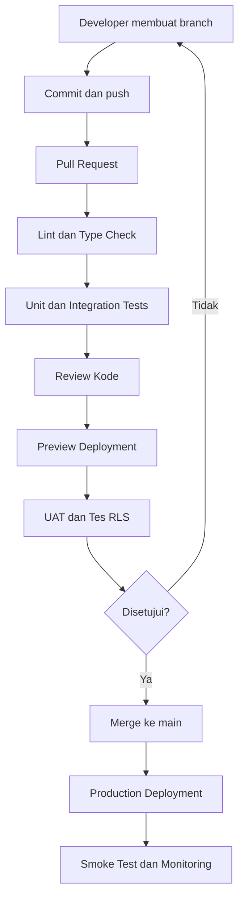

### Spesifikasi Lanjutan v2.1

### Detail Database, Security, API, UI, dan Prosedur Operasional

Spesifikasi lanjutan ini melengkapi rancangan sebelumnya untuk sistem pet shop dan klinik hewan berbasis Next.js + Supabase + Vercel. Fokusnya adalah detail yang biasanya dibutuhkan developer sebelum mulai menulis kode produksi: struktur SQL, transaksi atomik, kebijakan keamanan, standar API, aturan validasi, serta prosedur rilis.

Prinsip yang tetap berlaku:

* Stok pet shop dan klinik menggunakan inventori bersama.

* Pembayaran online dilakukan secara manual dan stok baru dialokasikan setelah pembayaran dikonfirmasi.

* Rekam medis yang sudah ditandatangani tidak boleh ditimpa langsung.

* Data pelanggan, hewan, cabang, dan keuangan dibatasi berdasarkan izin.

* Semua transaksi kritis harus konsisten walaupun request dikirim berulang atau terjadi bersamaan.

### 1\. Spesifikasi detail struktur database

### 1.1 Konvensi skema

Gunakan schema `public` untuk tabel aplikasi yang memang perlu diakses melalui Supabase Data API, dan pertimbangkan schema privat tersendiri untuk fungsi internal jika sesuai dengan konfigurasi proyek.

Konvensi yang diwajibkan:

* Semua tabel transaksi mempunyai `id`, `created_at`, dan identitas pembuat jika relevan.

* `updated_at` diperbarui melalui trigger atau mekanisme server yang konsisten.

* Uang disimpan sebagai `NUMERIC(14,2)` untuk mata uang dengan dua desimal, dengan validasi nilai nonnegatif sesuai jenis transaksi.

* Kuantitas barang menggunakan tipe numerik yang mendukung produk satuan dan produk timbang, misalnya `NUMERIC(14,3)`.

* Harga yang disimpan pada item transaksi adalah snapshot; perubahan harga katalog tidak mengubah transaksi lama.

* Gunakan `CHECK`, `UNIQUE`, dan foreign key untuk menegakkan aturan yang dapat ditegakkan di database.

* Jangan mengandalkan validasi frontend untuk integritas data.

* Status transaksi harus berupa enum PostgreSQL atau teks yang divalidasi melalui constraint; pilih salah satu secara konsisten dan kelola perubahan status melalui migration.

### 1.2 Tabel fondasi dan pengguna

| Tabel              | Kolom tambahan yang direkomendasikan               | Constraint penting                                           |
| ------------------ | -------------------------------------------------- | ------------------------------------------------------------ |
| branches           | code, name, timezone, is_active                    | code unik                                                    |
| profiles           | display_name, phone, is_active                     | id mengacu ke identitas Auth                                 |
| roles              | code, name, is_system                              | code unik                                                    |
| permissions        | code, description                                  | code unik                                                    |
| user_roles         | user_id, role_id, branch_id opsional               | kombinasi penugasan unik                                     |
| role_permissions   | role_id, permission_id                             | kombinasi unik                                               |
| user_branch_access | user_id, branch_id                                 | kombinasi unik                                               |
| audit_logs         | actor_id, action, entity_type, entity_id, metadata | hanya penambahan untuk pengguna aplikasi; perubahan dibatasi |

Pilih aturan jelas untuk peran global dan peran per cabang. Sebagai contoh, pemilik dapat mempunyai akses global, sedangkan dokter ditugaskan ke cabang tertentu. Hindari asumsi bahwa setiap pengguna memiliki satu peran saja jika kebutuhan sebenarnya memungkinkan beberapa penugasan.

### 1.3 Tabel inventori

| Tabel                    | Tujuan                                 | Aturan kritis                         |
| ------------------------ | -------------------------------------- | ------------------------------------- |
| products                 | Master barang                          | SKU unik sesuai kebijakan bisnis      |
| inventory_locations      | Gudang, toko, klinik, area penyimpanan | milik satu cabang                     |
| inventory_lots           | Batch dan kedaluwarsa                  | hanya bila relevan untuk produk       |
| stock_balances           | Saldo per produk dan lokasi            | satu baris per kombinasi kunci        |
| inventory_movements      | Ledger perubahan stok                  | tidak dihapus atau diedit sembarangan |
| stock_reservations       | Alokasi stok untuk pesanan             | unik per item/pesanan sesuai desain   |
| inventory_transfers      | Transfer antarlokasi                   | status dan penerimaan tercatat        |
| inventory_transfer_items | Detail transfer                        | jumlah positif                        |
| inventory_cost_layers    | Informasi biaya persediaan             | metode biaya konsisten                |

`stock_balances` adalah saldo operasional yang digunakan untuk pemeriksaan ketersediaan. `inventory_movements` merupakan jejak pergerakan yang diperlukan untuk rekonsiliasi. Keduanya harus diperbarui dalam transaksi database yang sama.

### 1.4 Tabel transaksi dan pembayaran

Pisahkan konsep pesanan, pembayaran, dan pemenuhan barang:

* `orders`: pesanan pelanggan dan status pemenuhan.

* `order_items`: barang, kuantitas, harga snapshot, diskon, dan total item.

* `payments`: catatan pembayaran beserta status konfirmasi.

* `payment_confirmations`: histori pemeriksaan/konfirmasi jika dibutuhkan untuk audit.

* `refunds`: permintaan dan status refund manual.

* `sales`: transaksi POS yang sudah diselesaikan atau masih berupa draft.

* `sale_items`: detail produk dan snapshot HPP.

* `sale_payments`: pembayaran yang terkait dengan penjualan POS.

* `idempotency_keys`: pencegahan transaksi ganda.

Hindari satu kolom `status` yang mencoba menggambarkan sekaligus status pembayaran, stok, dan pengiriman. Gunakan status terpisah agar kasus pembayaran berhasil tetapi stok perlu ditinjau dapat direpresentasikan secara benar.

### 2\. Kontrak database untuk operasi kritis

### 2.1 Operasi yang harus dijalankan secara atomik

Operasi berikut tidak boleh diimplementasikan sebagai rangkaian perubahan independen dari browser:

* Penyelesaian penjualan POS.

* Konfirmasi pembayaran pesanan online dan alokasi stok.

* Penerimaan barang dari supplier.

* Penyesuaian stok.

* Transfer stok dan penerimaan transfer.

* Pengeluaran obat dari inventori untuk pasien.

* Retur dan refund.

* Penutupan shift kasir.

* Penandatanganan rekam medis.

* Penempatan pasien ke unit rawat inap.

Gunakan fungsi database PostgreSQL yang dipanggil melalui RPC atau server-side API tepercaya. Operasi tersebut harus mengelola validasi, penguncian data, perubahan status, ledger, dan audit dalam satu transaksi.

### 2.2 Aturan penguncian stok

Saat memproses transaksi, sistem harus mengunci baris saldo stok yang akan berubah. Untuk transaksi yang mencakup beberapa produk, urutkan penguncian berdasarkan ID produk dan lokasi secara konsisten untuk mengurangi risiko deadlock.

Pseudocode:

```text
BEGIN

1. Validasi identitas, izin, cabang, dan status transaksi.
2. Ambil lock atas saldo produk yang diperlukan.
3. Hitung available = on_hand - reserved.
4. Pastikan available mencukupi.
5. Ubah saldo stok.
6. Tambahkan inventory movement.
7. Catat referensi transaksi dan audit.
8. Simpan hasil idempotensi.

COMMIT
```

Jika ada kegagalan pada langkah mana pun, perubahan transaksional harus dibatalkan. Implementasi juga harus menangani konflik serialisasi atau deadlock dengan retry yang terbatas dan aman.

### 2.3 Penggunaan obat klinik

Setiap penggunaan obat yang mengurangi inventori harus memiliki:

* Hewan dan kunjungan terkait.

* Produk dan kuantitas.

* Lokasi stok sumber.

* Dokter atau petugas yang berwenang.

* Waktu pemakaian.

* Referensi resep atau tindakan jika relevan.

* Catatan batch/lot dan kedaluwarsa bila diterapkan.

Jangan mengurangi stok hanya karena resep dibuat. Bedakan antara obat yang diresepkan, obat yang disiapkan, dan obat yang benar-benar dikeluarkan atau digunakan.

### 2.4 Retur dan refund

Pisahkan tiga tindakan:

* Retur barang: perubahan fisik barang dan stok.

* Refund: pengembalian uang kepada pelanggan.

* Pembatalan: penghentian transaksi yang belum diselesaikan atau workflow pembatalan sesuai statusnya.

Ketiganya dapat saling berhubungan, tetapi tidak selalu terjadi bersamaan. Barang yang dikembalikan harus diperiksa kondisinya sebelum stok dijadikan tersedia kembali. Refund manual harus memiliki catatan jumlah, alasan, persetujuan, pelaksana, dan referensi transaksi asal.

### 3\. Spesifikasi RLS dan otorisasi tingkat lanjut

### 3.1 Pola pemeriksaan akses

Setiap operasi harus memenuhi seluruh kondisi yang relevan:

* Pengguna terautentikasi dan aktif.

* Pengguna mempunyai izin untuk tindakan tersebut.

* Pengguna memiliki akses ke cabang terkait.

* Objek yang diakses berada dalam lingkup pelanggan atau penugasan pengguna.

* Status transaksi mengizinkan tindakan.

* Jika diperlukan, persetujuan tambahan sudah tersedia.

Untuk menghindari duplikasi logika, developer dapat membangun fungsi otorisasi database yang terkontrol. Namun, fungsi tersebut harus dirancang agar tidak dapat dipakai untuk melewati RLS.

### 3.2 Kebijakan per jenis data

| Jenis data                       | Kebijakan akses                                                            |
| -------------------------------- | -------------------------------------------------------------------------- |
| Profil pengguna                  | Pengguna membaca profil sendiri; pemilik mengelola sesuai izin             |
| Produk katalog                   | Data aktif dapat dibaca publik sesuai kebijakan toko                       |
| Harga internal/HPP               | Hanya peran operasional yang berwenang                                     |
| Stok                             | Hanya pengguna yang berizin; pelanggan tidak melihat seluruh stok internal |
| Pesanan                          | Pemilik pesanan dan staf berwenang sesuai cabang                           |
| Bukti pembayaran                 | Pelanggan pemilik dan staf pembayaran berwenang                            |
| Rekam medis                      | Dokter sesuai izin/penugasan serta peran lain yang secara sah diberi akses |
| Catatan internal rawat inap      | Staf klinis yang berwenang                                                 |
| Update rawat inap publik         | Pelanggan terkait hanya melihat informasi yang sudah dipublikasikan        |
| Pengeluaran dan laporan keuangan | Peran keuangan yang berwenang                                              |
| Audit log                        | Hanya peran audit/pemilik yang memiliki izin baca                          |

### 3.3 Batasan penting untuk Supabase

* RLS tidak menggantikan validasi bisnis pada server.

* Jangan membuat kebijakan yang hanya memeriksa `auth.uid() IS NOT NULL` untuk tabel sensitif.

* Jangan memberikan hak `UPDATE` umum pada tabel saldo stok atau rekam medis yang telah ditandatangani.

* Jika menggunakan `SECURITY DEFINER`, tetapkan `search_path` yang aman, batasi `EXECUTE`, dan pastikan fungsi tidak dapat dipakai untuk membaca atau mengubah data di luar kewenangannya.

* Uji RLS menggunakan akun nyata untuk setiap peran dan cabang, bukan hanya menggunakan akun service role.

* Secret key tidak boleh dipakai pada client-side code atau dimasukkan ke source map/browser bundle.

### 3.4 Audit log

Audit log minimal mencatat:

```text
actor_id
action
entity_type
entity_id
branch_id
occurred_at
request_id
reason
metadata
```

`metadata` hanya memuat informasi yang memang diperlukan untuk audit. Jangan menyalin kata sandi, token, data pembayaran sensitif, atau seluruh isi rekam medis ke log.

Audit log yang dapat dipercaya sebaiknya tidak bisa diubah atau dihapus melalui fungsi aplikasi biasa. Untuk kebutuhan audit lebih kuat, pertimbangkan ekspor log berkala ke penyimpanan terpisah yang aksesnya dibatasi.

### 4\. Spesifikasi validasi API dan error

### 4.1 Format respons

Respons sukses dapat menggunakan bentuk konsisten seperti:

```json
{
  "data": {
    "id": "resource-id",
    "status": "COMPLETED"
  },
  "meta": {
    "request_id": "server-generated-id"
  }
}
```

Untuk daftar dengan pagination:

```json
{
  "data": [],
  "meta": {
    "page": 1,
    "page_size": 20,
    "has_more": false
  }
}
```

### 4.2 Kode error

| Kode                     | Makna                                                        |
| ------------------------ | ------------------------------------------------------------ |
| VALIDATION_ERROR         | Input tidak valid                                            |
| UNAUTHENTICATED          | Sesi tidak tersedia atau tidak valid                         |
| FORBIDDEN                | Pengguna tidak mempunyai izin                                |
| NOT_FOUND                | Data tidak ditemukan atau tidak tersedia dalam lingkup akses |
| CONFLICT                 | Konflik status atau data                                     |
| INSUFFICIENT_STOCK       | Stok tidak mencukupi                                         |
| PAYMENT_REVIEW_REQUIRED  | Pembayaran perlu diperiksa                                   |
| INVALID_STATE_TRANSITION | Perubahan status tidak diizinkan                             |
| IDEMPOTENCY_CONFLICT     | Key idempotensi digunakan untuk request berbeda              |
| RATE_LIMITED             | Batas request terlampaui                                     |
| INTERNAL_ERROR           | Kesalahan internal tanpa detail sensitif                     |

Jangan membocorkan keberadaan objek milik pelanggan lain melalui pesan error yang terlalu spesifik. Untuk resource sensitif, `NOT_FOUND` dapat lebih tepat daripada memberi tahu bahwa objek tersebut memang ada tetapi tidak boleh diakses.

### 4.3 Validasi harga dan jumlah

Server wajib menghitung ulang:

* Harga produk yang berlaku.

* Diskon yang diizinkan.

* Kuantitas dan satuan.

* Biaya layanan/pengiriman bila berlaku.

* Total tagihan.

* Jumlah pembayaran yang dapat dikonfirmasi.

Browser hanya mengirim pilihan pelanggan dan data input. Total final tidak boleh dipercaya hanya karena dikirim dari UI.

### 5\. Spesifikasi modul per modul

### 5.1 Inventori

Fitur:

* Daftar barang, kategori, SKU, barcode, satuan, harga jual, HPP.

* Stok per cabang dan lokasi.

* Stok tersedia, stok dicadangkan, dan stok fisik.

* Mutasi stok dan riwayat pergerakan.

* Stock opname dan penyesuaian.

* Transfer antar-lokasi/cabang.

* Batch, tanggal kedaluwarsa, dan nomor lot jika diperlukan.

* Notifikasi stok minimum.

* Riwayat HPP dan rekonsiliasi saldo.

Kriteria selesai:

* Semua mutasi memiliki sumber dan referensi.

* Pengguna tidak dapat mengubah saldo secara langsung tanpa prosedur yang sah.

* Stok yang sama tidak dapat dijual dua kali melalui transaksi bersamaan.

* Laporan stok dapat direkonsiliasi dengan ledger mutasi.

### 5.2 POS

Fitur:

* Buka/tutup shift.

* Cari produk dengan nama, SKU, atau barcode.

* Keranjang dan perubahan kuantitas.

* Diskon sesuai izin.

* Pembayaran tunai dan metode manual lain.

* Invoice dengan nomor unik.

* Retur parsial/penuh.

* Rekap per shift dan metode pembayaran.

Kriteria selesai:

* Total transaksi dihitung server.

* Penyelesaian transaksi atomik.

* Request ganda tidak membuat invoice atau pergerakan stok ganda.

* Retur tidak mengubah transaksi asal secara diam-diam.

### 5.3 Klinik

Fitur:

* Jadwal dokter dan kunjungan.

* Profil pasien hewan.

* Riwayat kunjungan dan rekam medis.

* Keluhan, pemeriksaan, diagnosis, tindakan, resep, dan rencana kontrol.

* Catatan penggunaan obat.

* Tanda tangan/konfirmasi dokter.

* Amendemen rekam medis.

* Riwayat dokter yang menangani.

Kriteria selesai:

* Hak menandatangani diperiksa di server/database.

* Rekam medis bertanda tangan tidak bisa ditimpa langsung.

* Amendemen tidak menghilangkan versi sebelumnya.

* Admin tidak dapat melakukan tindakan klinis tanpa izin yang sah.

### 5.4 Rawat inap

Fitur:

* Daftar unit dan kapasitas.

* Pendaftaran dan pemulangan pasien.

* Penugasan dokter/petugas.

* Catatan observasi, tindakan, obat, dan perawatan.

* Ringkasan harian untuk pelanggan.

* Histori update yang dipublikasikan.

* Tagihan rawat inap.

Kriteria selesai:

* Kapasitas unit tidak terlampaui.

* Catatan klinis internal dan update pelanggan terpisah.

* Pelanggan hanya melihat update yang ditujukan untuk hewannya.

* Setiap update publik dapat ditelusuri ke pembuat dan waktu publikasi.

### 5.5 Toko online

Fitur:

* Katalog, pencarian, kategori, dan detail produk.

* Keranjang.

* Checkout dan alamat pengiriman.

* Instruksi pembayaran manual.

* Unggah bukti transfer.

* Status verifikasi pembayaran.

* Pickup dan delivery oleh admin.

* Invoice dan riwayat pesanan.

Kriteria selesai:

* Pesanan tidak otomatis mengurangi stok saat dibuat.

* Konfirmasi pembayaran memicu pemeriksaan stok ulang.

* Kekurangan stok menghasilkan `STOCK_REVIEW`.

* Admin dapat mengelola penyelesaian pesanan dan mencatat status pengiriman.

* Pelanggan tidak dapat mengakses pesanan pengguna lain.

### 5.6 Grooming dan penitipan

Fitur:

* Katalog layanan, durasi, harga, dan kapasitas.

* Booking dan perubahan jadwal.

* Check-in/check-out.

* Catatan kondisi hewan.

* Layanan tambahan dan persetujuan biaya.

* Rekap layanan dan pembayaran.

Kriteria selesai:

* Sistem mencegah booking melampaui kapasitas yang dikonfigurasi.

* Perubahan jadwal dan pembatalan tercatat.

* Biaya tambahan mempunyai persetujuan atau dasar yang jelas.

### 5.7 Keuangan

Fitur:

* Kas per cabang dan shift.

* Penerimaan dan pengeluaran.

* Piutang pelanggan.

* Tagihan supplier.

* HPP.

* Laporan penjualan, kas, dan laba rugi sederhana.

* Ekspor laporan.

* Penutupan periode dan koreksi terotorisasi.

Kriteria selesai:

* Penjualan, pembayaran, dan arus kas dibedakan dengan benar.

* Pembelian stok tidak langsung seluruhnya menjadi beban HPP.

* HPP transaksi lama tidak berubah akibat perubahan harga modal baru.

* Laporan dapat ditelusuri ke transaksi sumber.

### 6\. Spesifikasi antarmuka halaman

| Halaman           | Elemen wajib                                                             |
| ----------------- | ------------------------------------------------------------------------ |
| Login             | Email/nomor login sesuai kebijakan, password, reset password, error aman |
| Dashboard pemilik | Penjualan, kas, stok minimum, janji temu, ringkasan keuangan             |
| Dashboard dokter  | Jadwal, pasien hari ini, catatan klinis tertunda, rawat inap aktif       |
| Dashboard admin   | POS, pesanan, booking, pembayaran yang perlu diverifikasi                |
| POS               | Pencarian produk, keranjang, total, pembayaran, invoice                  |
| Inventori         | Filter cabang/lokasi, stok, mutasi, adjustment, transfer                 |
| Detail hewan      | Identitas, pemilik, riwayat kunjungan, dokumen                           |
| Rekam medis       | Riwayat, formulir klinis, resep, tanda tangan, amendemen                 |
| Rawat inap        | Unit/kandang, daftar pasien, observasi, tugas, update publik             |
| Pesanan online    | Item, pembayaran, stok, pickup/delivery, status                          |
| Keuangan          | Kas, biaya, piutang, HPP, laporan periode                                |
| Portal pelanggan  | Hewan saya, pesanan, invoice, janji temu, update rawat inap              |
| Pengaturan        | Pengguna, izin, cabang, harga, metode pembayaran, konfigurasi            |

### Perilaku UI wajib

* Tampilkan loading, empty state, success, dan error state.

* Gunakan dialog konfirmasi untuk operasi berisiko.

* Cegah pengiriman form berulang saat request berjalan, tetapi tetap terapkan idempotensi di server.

* Sediakan pagination dan pencarian server-side.

* Pertahankan aksesibilitas keyboard dan label form.

* Hindari mengandalkan warna saja untuk menunjukkan status.

* Pada perangkat kecil, prioritaskan tindakan utama dan kurangi kolom tabel yang tidak relevan.

### 7\. CI/CD dan prosedur deployment

### 7.1 Alur GitHub ke Vercel



### 7.2 Gerbang CI

Setiap pull request minimal menjalankan:

```bash
npm ci
npm run lint
npm run typecheck
npm run test
npm run build
```

Perintah di atas mengasumsikan script tersebut sudah didefinisikan di `package.json`. Tambahkan tes database dan E2E ke pipeline sesuai kebutuhan.

Jangan menjalankan migration destruktif secara otomatis pada setiap Preview Deployment. Migration production harus ditinjau, dijalankan dengan urutan yang aman, dan memiliki prosedur pemulihan.

### 7.3 Strategi migration

Gunakan pendekatan expand and contract untuk perubahan database berisiko:

* Tambahkan struktur baru tanpa langsung menghapus struktur lama.

* Deploy kode yang dapat menangani struktur baru.

* Migrasikan atau backfill data.

* Verifikasi hasil.

* Baru hapus struktur lama pada rilis terpisah setelah dipastikan tidak lagi digunakan.

Simpan migration dalam Git, uji di database staging, dan hindari perubahan skema manual yang tidak tercatat.

### 8\. Monitoring dan penanganan insiden

Pantau setidaknya:

* Error server dan kegagalan request.

* Kegagalan autentikasi yang tidak biasa.

* Query database lambat.

* Konflik stok dan transaksi yang gagal.

* Kegagalan upload berkas.

* Kegagalan job terjadwal.

* Kapasitas database dan Storage.

* Status deployment dan health check.

Untuk insiden kritis, prosedur minimum adalah:

* Identifikasi waktu dan dampak insiden.

* Hentikan sementara operasi yang berpotensi memperburuk inkonsistensi.

* Simpan request ID dan log yang relevan.

* Rekonsiliasi transaksi, stok, dan kas.

* Pulihkan layanan melalui prosedur yang disetujui.

* Dokumentasikan penyebab, dampak, dan tindakan pencegahan.

Jangan mengoreksi stok atau kas secara langsung di database produksi tanpa prosedur dan audit yang jelas.

### 9\. Daftar deliverable developer

### Checklist serah terima

0/15

Repository Next.js + TypeScript dengan struktur modular

Dokumentasi arsitektur dan keputusan teknis

Migration SQL dan seed data nonproduksi

RLS policies, grants, dan tes otorisasi

Fungsi database untuk transaksi kritis

Modul autentikasi dan pengelolaan peran

Modul inventori dan POS

Modul klinik dan rawat inap

Modul grooming, penitipan, dan toko online

Modul keuangan dan laporan

Tes unit, integrasi, keamanan, dan E2E

Konfigurasi CI/CD GitHub dan Vercel

Dokumentasi environment dan deployment

Runbook backup, restore, dan insiden

Panduan pengguna serta hasil UAT

 Salin daftar deliverable

### 10\. Keputusan yang harus dikunci sebelum coding

Beberapa hal belum ditetapkan secara rinci dan sebaiknya tidak dibiarkan menjadi asumsi developer:

* Apakah pelanggan dapat memiliki lebih dari satu akun atau wali untuk satu hewan?

* Apakah dokter dibayar berdasarkan gaji, komisi, atau hanya perlu laporan layanan per dokter?

* Apakah harga, stok, dan katalog produk dapat berbeda antar-cabang?

* Apakah obat memerlukan batch dan tanggal kedaluwarsa sejak MVP?

* Apakah pembayaran parsial dan piutang pelanggan diperlukan sejak versi pertama?

* Apakah setiap cabang memiliki kasir dan metode pembayaran tersendiri?

* Apakah invoice memerlukan format nomor yang berbeda per cabang?

* Berapa jumlah pengguna bersamaan yang diperkirakan pada jam sibuk?

Keputusan tersebut berpengaruh pada skema database, indeks, laporan, dan izin. Jika belum ada kebutuhan khusus, implementasi sebaiknya memakai konfigurasi yang fleksibel tetapi tidak menambah kompleksitas yang belum diperlukan.

### Rekomendasi akhir

Langkah implementasi berikutnya adalah membuat fondasi repository dan migration database tahap pertama, lalu menguji autentikasi, RLS, cabang, dan model inventori sebelum membangun POS. Ini merupakan urutan yang paling aman karena seluruh modul lainnya bergantung pada identitas, otorisasi, dan konsistensi stok.

Spesifikasi lanjutan ini belum berarti kode atau deployment telah dibuat. Tahap berikutnya perlu menghasilkan artefak konkret—source code, migration SQL, tes, serta konfigurasi Vercel dan Supabase—dan memverifikasi semuanya di lingkungan staging sebelum produksi.
